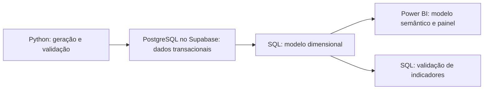

# BI de Vendas

Projeto de portfólio para analisar o desempenho de um varejista brasileiro fictício. O painel executivo responderá quanto a empresa vendeu, onde a receita cresceu, quais produtos lideraram e como o faturamento evoluiu em relação às metas.

O período inicial planejado vai de janeiro de 2024 a junho de 2025. A base será sintética, reproduzível por semente e abrangerá as cinco regiões brasileiras. Os números da referência visual servem apenas para ilustrar o layout.

## Estado do projeto

A fase 1 preparou o ambiente e a estrutura do repositório. A fase 2 definiu o [modelo dimensional](docs/modelagem-dimensional.md) e seu [dicionário de dados](docs/dicionario-dados.md). Uma linha de venda representa um item de pedido. Uma linha de meta representa o faturamento planejado para um mês e uma região.

## Estrutura

| Caminho | Finalidade |
| --- | --- |
| `supabase/migrations/` | Migrações PostgreSQL versionadas. |
| `sql/consultas/` | Consultas analíticas e conferência de indicadores. |
| `src/bi_vendas/` | Geração, validação e carga em Python. |
| `tests/unitarios/` e `tests/integracao/` | Testes com e sem dependência do banco. |
| `powerbi/` | Projeto editável do Power BI, com PBIP, TMDL e PBIR conforme compatibilidade. |
| `recursos-visuais/` | Recursos gráficos e capturas da demonstração. |
| `docs/` | Diagnóstico, plano e documentação técnica. |
| `.github/workflows/` | Automação de testes após a implementação do pipeline. |

Consulte o [ambiente verificado](docs/ambiente.md), a [arquitetura de dados](docs/arquitetura.md), as [decisões técnicas](docs/decisoes-tecnicas.md) e o [plano de implementação](docs/plano-implementacao.md).
