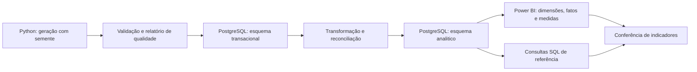

# Arquitetura de dados

O PostgreSQL do Supabase armazenará a origem transacional e o modelo dimensional em esquemas separados. O pipeline Python gerará e validará uma base de varejo fictícia. O Power BI consumirá as dimensões e os fatos analíticos em modo Importação, sujeito à validação da conexão e da atualização na fase 5.

| Componente | Contrato |
| --- | --- |
| Geração | Cenário reproduzível por semente e parâmetros. Referência inicial de 15 mil clientes, 500 produtos, dezenas de milhares de pedidos e cinco regiões brasileiras, com vendas e metas de janeiro de 2024 a junho de 2025. |
| `transacional` | Catálogos, cabeçalhos, itens de pedido e metas informadas. Preserva dados de entrada e aplica integridade de chaves e regras do pedido. |
| Transformação | Resolve as chaves do modelo dimensional, deriva mês, região e faturamento do item e verifica a origem dos valores. Dimensões são carregadas antes dos fatos. |
| `analitico` | Duas estrelas com dimensões compartilhadas de mês e região. As tabelas concentram os contratos de leitura do Power BI e das consultas SQL. |
| Power BI | Usa relações de filtro da dimensão para o fato e medidas explícitas para indicadores. A validação compara resultados SQL e DAX com os mesmos filtros. |

## Carga e acesso

- A carga inicial será em lote. O desenho prevê atualização por chave e publicação transacional de cada lote coerente, incluindo a validação da cobertura das metas. A estratégia de reprocessamento e o tratamento de mudanças na população sintética serão detalhados na fase 4.
- O desenho prevê três perfis PostgreSQL com privilégios distintos. A administração aplica migrações, o pipeline grava nos dois esquemas e o Power BI lê as tabelas do esquema `analitico`.
- Os esquemas do projeto ficarão fora da lista de esquemas expostos pela Data API. As credenciais do pipeline serão fornecidas ao processo pelo ambiente. O Power BI armazenará sua própria credencial de leitura. [Esquemas personalizados no Supabase](https://supabase.com/docs/guides/api/using-custom-schemas)
- Os identificadores de clientes e vendedores representam dados sintéticos. A estrutura usa códigos, rótulos fictícios e localidade no nível de UF.

O conector Supabase retornou zero tabelas para a consulta aos esquemas `public`, `transacional` e `analitico` durante a fase 2. As estruturas neste documento são o desenho para as migrações da fase 3.
