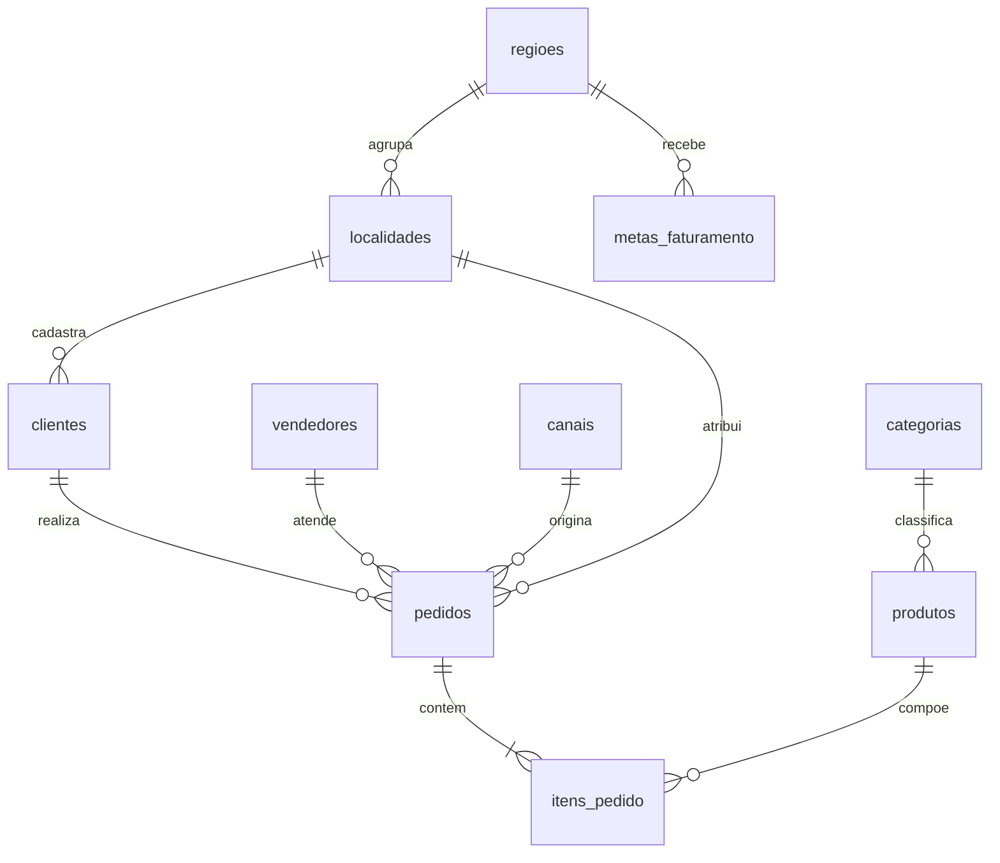
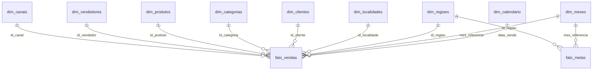

# Modelagem transacional e dimensional

## Modelo transacional

Cada pedido pertence a um cliente, um vendedor, um canal e uma UF de atribuição. O cabeçalho concentra data e situação do pedido. Cada item registra um produto, quantidade, preço unitário praticado e desconto total do item. O preço praticado preserva o valor da venda ao longo do tempo. Uma meta de faturamento é cadastrada por mês e região.

Cada item deve apontar para um pedido existente e cada pedido publicado deve ter pelo menos um item. A chave estrangeira garante a primeira direção. A validação do lote garante a segunda. A situação do cabeçalho se aplica a todos os seus itens. A UF é capturada do cadastro do cliente quando o pedido é criado e permanece registrada no pedido para preservar a atribuição histórica.

## Modelo dimensional

| Fato | Grão | Chave primária | Semântica |
| --- | --- | --- | --- |
| `fato_vendas` | Um item de pedido, com pedidos concluídos e cancelados. | `(id_pedido, numero_item)` | Quantidade, valores do item e situação. A UF vem do cabeçalho do pedido. |
| `fato_metas` | Uma meta de faturamento por mês de referência e região. | `(mes_referencia, id_regiao)` | Valor previsto para o mês inteiro na região. As cinco regiões e os 18 meses da base inicial formam 90 combinações esperadas. |

Os relacionamentos do Power BI são ativos, de um para muitos e com filtro da dimensão para o fato. Cada coluna indicada no diagrama é uma chave estrangeira do fato. As chaves compostas adicionais do PostgreSQL garantem que o mês corresponda à data e que a região corresponda à UF. No Power BI, o filtro usa as relações simples indicadas no diagrama.

## Filtros de período e região

| Recorte | Faturamento | Meta e percentual da meta |
| --- | --- | --- |
| Meses completos, via `dim_meses` | Soma o faturamento dos itens nos meses selecionados. | Considera uma meta por mês e região no contexto. |
| Região ou conjunto de regiões, via `dim_regioes` | Usa a região registrada em cada pedido. | Soma as metas das regiões selecionadas. |
| Dia, UF, produto, categoria, cliente, canal, vendedor ou situação | Aplica o filtro ao fato de vendas. | As medidas devem ficar em branco no recorte, pois o plano tem grão mensal e regional. |

Os filtros da visão executiva e os eixos de comparação com metas usarão `dim_meses` e `dim_regioes`. A chave de mês é o primeiro dia do mês. `dim_meses` contém os 18 meses da cobertura inicial. `dim_calendario` contém um registro por dia, de janeiro de 2024 a dezembro de 2025, inclusive, para sustentar análises de datas com anos completos. A data diária é usada em visuais de vendas. [Orientação sobre tabelas de data no Power BI](https://learn.microsoft.com/en-us/power-bi/guidance/model-date-tables)

O percentual da meta é o faturamento dividido pela meta somada, calculado no contexto atual. Se faltar uma meta para algum par mês e região selecionado, a carga deve sinalizar a lacuna e as medidas de meta e atingimento ficam em branco enquanto a cobertura estiver incompleta. Se as metas estiverem completas e o recorte publicado tiver zero vendas concluídas, o atingimento é 0%.

## Indicadores de vendas

- **Faturamento** é a soma do valor reconhecido por item. Pedidos concluídos contribuem com o bruto menos o desconto. Itens de pedidos cancelados contribuem com zero.
- **Vendas** são pedidos concluídos distintos. **Unidades vendidas** somam quantidades de itens concluídos. Essa distinção evita inflar o card de vendas com pedidos de vários itens.
- **Clientes ativos** são clientes distintos com pelo menos um pedido concluído no recorte. **Clientes recorrentes** têm pelo menos dois pedidos concluídos distintos no recorte.
- **Ticket médio** divide faturamento por pedidos concluídos distintos. Quando o denominador é zero, o indicador fica em branco. Valores distintos e médias são recalculados em cada subtotal.
- **Vendas por categoria** usa unidades vendidas, que são aditivas mesmo quando um pedido contém itens de várias categorias.
- **Variação mensal** compara um mês com o anterior. A variação do card executivo compara a seleção contínua de meses com a janela imediatamente anterior de mesma duração. A comparação anual usa os mesmos meses do ano anterior. As comparações ficam em branco quando faltar cobertura em uma das janelas ou quando a base de comparação for zero.

Veja os nomes, tipos e domínios no [dicionário de dados](dicionario-dados.md) e as escolhas em [decisões técnicas](decisoes-tecnicas.md).
